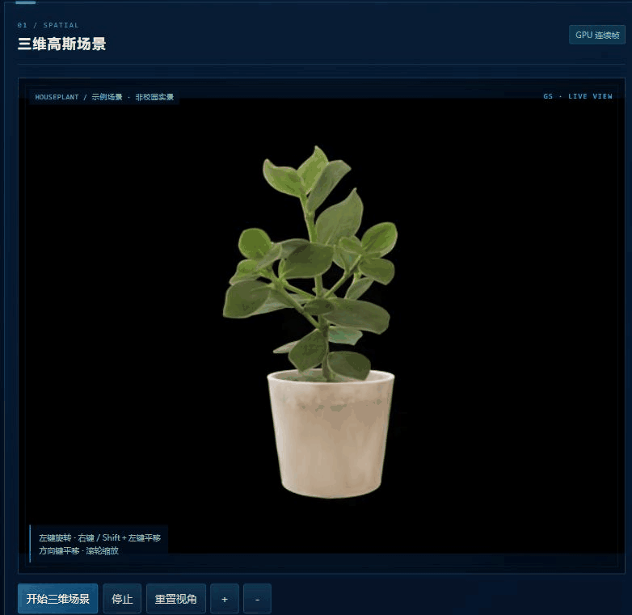
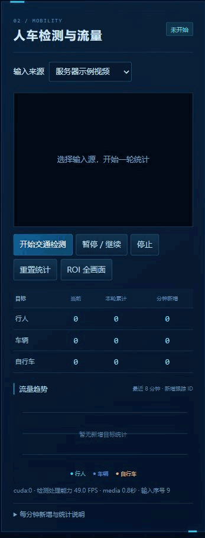
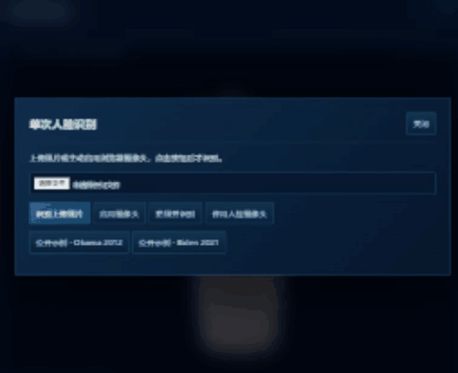

# 智慧校园演示系统 · GPU版

GPU 第 1 版：中央三维高斯场景、左侧人车流量、右侧人员识别。使用 Django 和原生 JavaScript，Web 与 GPU 服务分别运行。无需数据库、Node.js 或云推理服务。

<details>
<summary>查看完整看板</summary>


</details>

已在 Windows 11 / RTX 3050 Laptop 4 GB 验证全量 Houseplant（113648 个高斯，640×480）、YOLOv8n + ByteTrack 与 YuNet/SFace 的 CUDA 执行。性能实测和范围见 [性能报告](docs/GPU_PERFORMANCE.md) 与 [验收记录](VALIDATION.md)。

## 功能演示

三段 GIF 均录自本机运行的网页，使用仓库自带的公开场景、视频和照片。[素材来源与许可](docs/ASSETS.md)

### 3DGS 视角交互

点击「开始三维场景」加载 Houseplant。左键拖动旋转，右键、中键或 Shift＋左键拖动平移，滚轮或「＋／－」缩放。聚焦窗口后也可用方向键平移，按住 Shift 加速。动图依次展示旋转、放大、平移和重置视角。



### 人车流量监测

选择「服务器示例视频」并开始检测，画面显示检测框、跟踪 ID 和轨迹，下面同步更新当前数量、累计数量和每分钟新增。框选 ROI 会开启新一轮统计，动图也演示了暂停和继续。



### 人脸识别

首次使用时，在「人员管理」录入公开示例 Obama 2009，再打开「识别一次」。动图先用同一人的 Obama 2012 照片匹配通过，再用未登记的 Biden 2021 照片得到未知人员结果。弹窗展示照片、相似度和阈值，识别结果写入历史。



## 从零上手：Windows 本机运行全部功能

下面的命令在 **Anaconda Prompt** 中执行。本机全部运行需要 NVIDIA 显卡；**没有独显的学生电脑只做第 1、2 步，再按[远程接入](#没有-gpu学生电脑如何接入)连接 GPU 服务**。

### 1. 克隆项目

```bat
git clone --recurse-submodules https://github.com/Dwyanelittle64c/smart_campus_demo_gpu.git
cd smart_campus_demo_gpu
```

上面的命令会一并克隆 gsplat 和 GLM 子模块。若已普通克隆，在项目根目录补执行 `git submodule update --init --recursive`。项目自带公开场景、权重、示例视频和测试照片。[素材来源与许可](docs/ASSETS.md)

### 2. 创建 Web 环境（Windows x64）

```bat
conda env create -f environments\windows-web.yml
conda activate smart-campus-gpu-web
python -m pip install -r environments\windows-web.freeze.txt
python -m pip check
```

Web 只需要 Django、ASGI 服务和网络转发依赖，不安装 PyTorch、CUDA 或 OpenCV。已经创建同名环境时，可跳过 `conda env create`，直接激活并核对依赖。

### 3. 创建 GPU 环境并编译 gsplat（Windows x64）

先准备可运行 `nvidia-smi` 的 NVIDIA 驱动、**CUDA Toolkit 12.1**、Visual Studio 2022 Build Tools（选 **使用 C++ 的桌面开发**、**MSVC v142 14.29 x64/x86 工具集**和 Windows SDK），以及 PowerShell 7（`pwsh`）。`nvidia-smi` 显示的是驱动支持上限；即使能看到 GPU，也仍需要 Toolkit 的 `nvcc.exe` 才能编译扩展。

```bat
conda env create -f environments\windows-runtime.yml
conda activate smart-campus-gpu-runtime
python -m pip install -r environments\windows-runtime.lock.txt
python scripts\check_assets.py
python -c "import torch; print(torch.__version__, torch.version.cuda, torch.cuda.is_available()); print(torch.cuda.get_device_capability(0))"
pwsh -NoProfile -File scripts\build_gsplat.ps1
python scripts\check_environment.py runtime --gpu
```

锁文件固定 PyTorch 2.4.1 + CUDA 12.1、OpenCV、ORT GPU 等已验证依赖。构建脚本默认使用 Toolkit 路径 `C:\Program Files\NVIDIA GPU Computing Toolkit\CUDA\v12.1`，目标架构 `8.6`（本机 3050）。路径不同可传 `-Cuda "实际路径"`；其他显卡以自检返回的计算能力设置 `-Architecture`，前提是工具链支持该架构。首次编译约数分钟，日志在 `docs/setup/gsplat-build-windows.log`。现有 GPU 服务运行时请先停掉它再重编译，以释放 `.pyd`。

自检失败时，先核对子模块、Toolkit 和 MSVC 工具集，详见 [GPU 环境与排障](docs/GPU_SETUP.md)。Linux/A100 按该文档单独编译，不能复用 Windows 二进制。

### 4. 启动服务

打开两个 **Anaconda Prompt** 窗口，都进入克隆后的项目根目录。

```bat
:: 窗口 1：GPU 算法服务，127.0.0.1:8011
conda activate smart-campus-gpu-runtime
python scripts/run.py gpu
```

```bat
:: 窗口 2：Web 页面和同源网关，127.0.0.1:8010
conda activate smart-campus-gpu-web
python scripts/run.py web
```

两个窗口保持开启，访问 [智慧校园网页](http://127.0.0.1:8010/)，点击“开始三维场景”或“开始交通检测”。如果网页提示 GPU 未连接，先打开 [GPU 健康检查](http://127.0.0.1:8011/health/) 或查看窗口 1 的输出。首页和健康检查不加载模型。

停止时在各自窗口按 **Ctrl+C**，或在项目根目录激活 Web 环境后执行 `python scripts/stop.py all`。停止脚本只处理本项目登记的进程；独立实例需传对应 `--config` 与 `--port`。

## 没有 GPU：学生电脑如何接入

学生电脑完成克隆和 Web 环境安装后，向管理员获取服务器和组实例信息。在一个终端保持 SSH 隧道（把 `USER@SERVER` 换成实际账号和地址；`18011` 为示例远端端口）：

```bat
ssh -N -L 8011:127.0.0.1:18011 USER@SERVER
```

另一终端在项目根目录启动 Web，然后打开 [8010 页面](http://127.0.0.1:8010/)：

```bat
conda activate smart-campus-gpu-web
python scripts/run.py web --config config/student-remote.json
```

服务器端部署、组实例配置和端口转发见 [学生交接](docs/STUDENT_HANDOVER.md)。A100/Linux 服务器方案尚未实机验收。

## 摄像头与性能验收

浏览器摄像头由打开网页的电脑提供，启用时需要授权。交通和人脸共用采集流，关闭最后一个预览后释放摄像头。RTSP 由 GPU 服务端连接。

展开 GS 的「执行设备与性能验收」可复测 GS 单独运行、交通并行、三模块并行和 10 分钟稳定性。三模块模式使用公开照片识别，产生标记为公开示例的记录。GS 静止时网页帧率会回零，交通示例视频按原始 10 FPS 媒体时间播放。[验收记录](VALIDATION.md)

## 配置和数据

默认 `config/local-3050.json`。可复制为自己的配置并传 `--config`，或设置 `CAMPUS_CONFIG`；不包含真实凭证。变更后重启，三模块开关在GPU端强制执行并同步页面。

|配置|用途|
|---|---|
|local-3050.json|本机双进程，完整场景640×480|
|student-remote.json|学生只运行Web，8011经SSH转发远端GPU|
|linux-a100.json|组实例示例，端口18011/data_root独立；未A100实测|

scene.package指向data_root下包含scene.ply/camera.json/source.json/许可的包。支持标准INRIA PLY位置、log scale、logit opacity、wxyz、完整可用SH；普通XYZ/RGB点云和任意.pth拒绝。`max_gaussians=null`表示全量，`sh_mode=auto`使用真实可用阶数；公开DC/抽样性能对照可以配置，但不能当作全量基线成绩。尺寸是实际输出像素，不是CSS放大尺寸。

相机支持CV world_to_camera和完整fx/fy/cx/cy/width/height/near/far，也兼容原position/center/up；不改世界尺度。换包后重启，检查两视角及输入数量。Houseplant由量化.splat转换，原本只有DC；GPU不会恢复已丢失的高阶细节。

业务权威存储在GPU的data_root：

|路径|重启行为|
|---|---|
|scenes / videos / test_faces / uploads|保留素材；上传生成asset_id|
|faces/people.json、UUID目录|保留原图、对齐脸、单位特征与版本|
|recognitions/events.jsonl、images|历史最新在前，独立快照保留|
|runtime/traffic-roi.json|ROI保留|
|交通计数、Tracker、活动相机|重启清零/关闭|

删除人员与清空历史是不同操作；前者不会破坏旧快照，后者不删除人员、模型、视频或场景。损坏索引不自动覆盖为空库。余弦阈值0.363只是已用公开夹具核验的起点，不是准确概率；没有活体或真实门禁安全承诺。

## 学生和后续开发

无GPU电脑只安装web，使用 [STUDENT_HANDOVER](docs/STUDENT_HANDOVER.md) 的SSH转发路径。服务器配置/组数据根可由 `scripts/init_instance.py` 创建，只复制公开样例，不复制业务库。训练是可选第三环境，参见 [3DGS_TRAINING](docs/3DGS_TRAINING.md)；流程为COLMAP→训练服务器→导出完整场景→GPU加载→学生网页，不让轻薄本本地渲染。

[ARCHITECTURE](docs/ARCHITECTURE.md) 解释协议、背压、会话与调度；[DEVELOPMENT](docs/DEVELOPMENT.md) 解释模块、开关、新增功能和测试。正常运行不自动下载或重新编译扩展。缺模型只影响对应模块；GPU不可用会明确失败，不偷偷转CPU。

Git 中保存代码、依赖锁、公开演示素材、报告、截图和 GIF。上传文件、人员库、识别历史、本机配置及原始日志存放在本地。[复现说明](VALIDATION.md)
