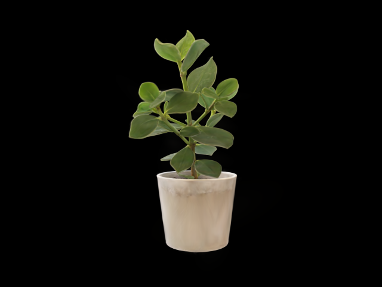

# GS / 三模块 GPU 性能报告

Git 仓库保留汇总表和代表性图像。原始 JSON、CSV 与构建/设备日志在验收机器本地，复测命令会重新生成。

2026-11-06～07，Asia/Shanghai；Windows11，i5-12500H（16逻辑线程）、16GB，RTX3050 Laptop4GB，驱动596.21。原生Windows CUDA12.1.105 + torch2.4.1+cu121/cuDNN9.1，gsplat1.5.3固定commit937e29912570c372bed6747a5c9bf85fed877bae。本机实测，不是A100或上游硬件成绩。

## 主要判定

完整Houseplant **113648高斯，真实640×480，原始相机构图、正常旋转/常用缩放**，三组60秒网页验收均达到20FPS目标；默认保持该档。输入到解码/rAF提交P95均小于150ms。三模块模式的真实人脸结果、交通前向CUDA输入/输出及处理新视频帧证据嵌入原始JSON。

|工况|秒|不同新帧|网页实际FPS|核心能力估计FPS¹|核心mean/P50/P95 ms|输入延迟mean/P50/P95 ms|JPEG Mbps|
|---|---|---|---|---|---|---|---|
|gs-only|60|2475|41.25|238.9|4.19/3.78/6.78|19.9/18.5/24.8|6.62|
|gs-traffic|60|2427|40.45|234.7|4.26/4.10/5.66|29.1/24.6/54.8|6.49|
|gs-traffic-face|60|2408|40.13|238.3|4.20/4.02/5.58|28.9/24.5/54.7|6.43|
|stability|600|24722|41.20|239.2|4.18/3.80/6.66|20.2/18.5/25.1|6.66|

¹ 1000/核心平均毫秒仅为计算能力估计，不含编码、网络、显示或调度等待；网页列只统计实际收到、解码并提交的不同JPEG。页面可见，首帧之后再预热2秒，随后完整60/600秒；逐帧epoch/frame/request、真实数量/尺寸、相机、JPEG SHA256和浏览器同一单调时钟都保存。没有拿rAF次数、心跳、旧图或抽样档当成绩。

三模块模式每约10秒用另一张公开Obama2012照片实际比对一次，六次有效返回；登记使用2009年不同拍摄。未知Biden2021另测不通过。vtest为10FPS真实视频，不能据此声称交通视频20/30FPS；检测处理能力、媒体播放和GS显示分别计。

## 资源与稳定性

CPU为GPU服务进程按16逻辑线程归一；RSS为该进程工作集，不是整个浏览器/Web/操作系统内存。GPU为nvidia-smi整卡统计，包含桌面、浏览器及其他应用，不能说都是高斯张量。

|工况|GPU服务平均CPU|峰值RSS MB|整卡平均GPU利用率|整卡显存中位/峰值 MB|
|---|---|---|---|---|
|gs-only|3.1%|1430.4|25.1%|1377/1381|
|gs-traffic|5.0%|1447.2|30.2%|1389/1406|
|gs-traffic-face|5.0%|1391.8|29.6%|1524/1544|
|stability|3.1%|1502.0|25.2%|1518/1604|

10分钟有24722张不同新帧，重连0次，客户端最新待办覆盖3帧。RSS前后30次采样中位数1384.54→1385.15MB（变化0.62MB）；PyTorch活跃张量显存40.46～40.96MB。整卡显存中位数1515→1578MB，存在桌面/浏览器/驱动缓存波动；不据此宣称所有GPU内存完全不变。后端张量与RSS在本轮记录内稳定，原始采样全部保留。

## 原生门槛与分段计时

每视角300张不同RGB，默认、旋转、常用缩放、0.35×距离极近景分别测；640×480、1280×720、1920×1080共3600帧。RGB非黑覆盖/可见数/代表性PNG及完整mean/P50/P95见[TABLES](performance/TABLES.md)、native-113648.json和native-stages.csv。只做了本机高分辨率原生测试，未宣称其三模块网页20FPS通过。

原生12组总过程（包含RGB hash/图像检查）平均CPU 6.1%，峰值RSS 703.0MB；整卡平均GPU利用率16.8%，显存中位/峰值1259/1265MB。这是整个基准进程过程采样，未按单个视角拆分，也未把整卡占用当作纯渲染张量。

首次导入2395.6ms，场景初始化188.8ms，其中PLY读取/上传显存在scene字段单列；首次前向731.3ms（显式准备，不是稳态帧）。PyTorch峰值分配111.6MB，不含CUDA上下文与其他应用。首次源码扩展编译约6分钟日志窗口，复用object重建耗时另见setup/gsplat-build-timing.json。

核心以实际stream的CUDA events覆盖完整gsplat前向，并同步后读时长；上游未公开此接口的投影/排序/合成分段计时，因此没有编造。单GPU工作线程公平轮转，短任务串行；同步不会和本实例另一个长GPU任务重叠。转换在GPU、GPU→CPU、CPU RGB→BGR、JPEG编码分别计，server_ms为含其他准备/可见数同步的墙钟。原生吞吐还含hash/非空校验和代表图保存，不能和纯核心能力估计混为一谈。

|尺寸|默认核心P95|近景核心P95|默认/近景服务墙钟P95|
|---|---|---|---|
|640×480|4.78ms|5.36ms|9.60/12.02ms|
|1280×720|5.36ms|6.39ms|17.43/19.07ms|
|1920×1080|7.39ms|10.56ms|31.10/36.72ms|

## 正确性、来源与边界

场景源SHA256 a3b5d0466105baecceb2119760eee0a646aee378981f1ff24c804b860d490588；camera.json与复制时hash一致。全量加载，无抽样、无拉远、无半尺寸冒充。classic、eps2d0.3、radius_clip0，黑色背景；SH degree0是量化源真实可用信息，未伪称恢复高阶。

两真实视角MAE与PNG见gpu-selfcheck；椭圆长宽比4.96、旋转相关0.922、前蓝后红中心[54,0,178]，非中心fx≠fy峰值[81,52]；degree1非零SH夹具红色随方向101→128，CV外参保持。许可明确的真实高阶SH场景尚未取得，不能把合成夹具替代真实Houseplant性能。

部署没有显示器/OpenGL/X11要求，统一CPU JPEG，不假定A100有NVENC。A100、真实校园网/RTT/带宽、真实RTSP成功连接、真实校园COLMAP训练/恢复均未实机验证。模拟慢消费者仅验证背压，不冒称远程网络成绩。摄像头另以用户授权的本机真实设备检测验证，未做身份比对、未保存画面；未用摄像头成绩替代GS基线。

## 命令与原始证据

```powershell
./scripts/build_gsplat.ps1
conda run --no-capture-output -n smart-campus-gpu-runtime python scripts/check_scene_gpu.py
conda run --no-capture-output -n smart-campus-gpu-runtime python scripts/check_geometry.py
conda run --no-capture-output -n smart-campus-gpu-runtime python scripts/check_face_gpu.py
conda run --no-capture-output -n smart-campus-gpu-runtime python scripts/benchmark_scene.py --sizes 640x480 1280x720 1920x1080
# 启动web/gpu后，在实际可见浏览器点击三种60秒工况及10分钟稳定性
conda run --no-capture-output -n smart-campus-gpu-web python scripts/verify_reports.py
conda run --no-capture-output -n smart-campus-gpu-web python scripts/summarize_performance.py
```

performance目录保留原始JSON、逐帧CSV、PNG和UI截图；setup目录保留CUDA/ORT执行、HTTP/WS、模块关闭、摄像头、上传/黑边ROI、RTSP错误路径与测试日志。没有复制旧CPU缓存/旧性能成绩。



[另一真实视角](performance/houseplant-view-0.6.png)、[极近景640×480](performance/113648-640x480-near-stress-150.png)、[三模块网页验收截图](performance/ui/three-modules.jpg)、[公开照片通过](performance/ui/face-pass.jpg)、[未知结果](performance/ui/face-unknown.jpg)。
